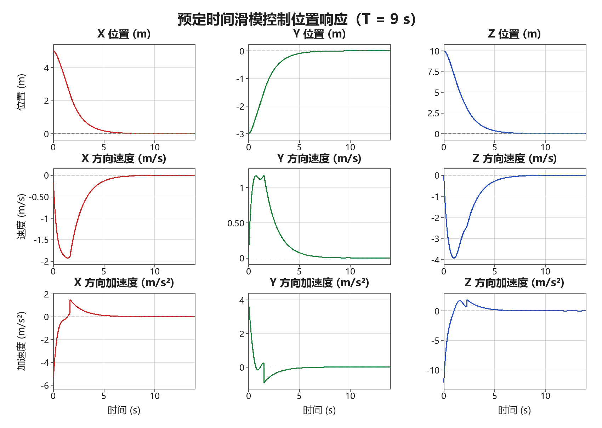

# 一种基于预定时间滑模与分段增益调度的四旋翼无人机位置跟踪方法

**quadrotor-prescribed-time-smc** · 预定时间滑模控制 + 分段增益调度的四旋翼无人机位置跟踪
（MATLAB / Python 双实现）

---

## 1. 方法概述

位置—姿态双环串级结构：

```
期望位置 ─► 预定时间滑模外环 ─► 力/力矩分配 ─► 一阶低通滤波 ─► 内环 PID ─► 四旋翼动力学
                    ▲                                                        │
                    └──────────────── 位置/姿态状态反馈 ◄────────────────────┘
```

四项关键设计：

| 环节 | 作用 | 实现位置 |
| --- | --- | --- |
| 含延时补偿项的滑模面 `s = e2 − a·e1 + K(t)·e1(t−h)` | 收敛时间上界由预设时间 `T` 决定，与初始误差无关 | `src/quadrotor_smc.m` |
| 分数幂吸引项 + 鲁棒切换项 | 小误差区强吸引、大误差区平滑，兼顾到达速度与抖振 | `src/quadrotor_smc.m` |
| 姿态指令一阶低通滤波 | 抑制位置环输出的高频换向，降低内环跟踪压力 | `src/quadrotor_smc2.m`、`scripts/low.m` |
| 分段增益调度（滑模 → PID） | 到达阶段后切换为 PID 保持，兼顾快速性与稳态平滑 | `scripts/SMC_fin.m` |


## 2. 主要结果

预设收敛时间 `T = 9 s`，初始位置 `(5, −3, 10) m`，目标 `(0, 0, 0)`，
扰动幅值 `0.5 N`（0.5 / 0.6 / 0.7 Hz）：

| 控制方案 | 5 cm 收敛/s | 1 cm 收敛/s | 末端误差/m | 姿态跟踪 RMS/(°) | 指令变化率/(°·s⁻¹) |
| --- | --- | --- | --- | --- | --- |
| 纯预定时间滑模 | 7.48 | 9.51 | 2.5×10⁻⁴ | 2.00 | 2807 |
| 滑模 + 指令滤波 | 7.48 | 9.51 | 2.5×10⁻⁴ | 1.34 | 899 |
| 滑模 → PID 分段 | 7.48 | 8.64 | 4.2×10⁻³ | 2.02 | 4345 |
| 滤波 + 分段（推荐） | 7.48 | 8.64 | 4.2×10⁻³ | 1.34 | 899 |



## 3. 目录结构

```
.
├── src/                  MATLAB 核心函数（外环滑模、内环 PID、姿态测试）
├── scripts/              MATLAB 仿真脚本（单环、双环、滤波对比、分段切换、综合）
├── tools/                Python 复算与制图工具（参考实现、CSV 导出、绘图）
├── data/
│   ├── raw/              原始仿真记录（.mat，MATLAB v5 格式）
│   └── processed/        整理后的 CSV 时序数据与性能指标
├── figures/              报告与文档使用的全部插图（PNG）
├── docs/                算法说明与专利体例技术文档
├── startup.m           将 src/ 加入 MATLAB 搜索路径
├── CITATION.cff        引用信息
└── LICENSE             MIT
```

## 4. 快速开始

### 4.1 MATLAB（R2016b 及以上）

```matlab
cd quadrotor-prescribed-time-smc
startup                       % 把 src/ 加入路径
run('scripts/SMC.m')          % 外环 + 内环双环仿真
run('scripts/SMC_fin.m')      % 滤波 + 分段切换（推荐配置）
```

脚本会在当前目录生成图窗与控制台指标；`quadrotor_smc(desired_pos, T)` 返回
`t`、姿态指令 `angles` 与控制力 `control_forces`。

### 4.2 Python（复算与制图，无需 MATLAB）

```bash
python -m pip install numpy pillow
python tools/export_results.py     # 复算四种方案 → data/processed/*.csv
python tools/make_figures.py       # 生成 figures/fig1..fig7
python tools/fig_flow.py           # 生成流程图与结构框图
```

`tools/qsmc_sim.py` 是 `quadrotor_smc.m` + `PID_smc.m` 的等价 Python 实现，
用于在没有 MATLAB 许可证的机器上复现结果与做回归测试。

## 5. 数据说明

- `data/raw/*.mat`：MATLAB 原始记录（`simulation_results` 结构体，含 `t`、`x_pos`、
  `roll_desired` 等 17 个字段），保留用于追溯。
- `data/processed/*.csv`：按 100 Hz 重采样的整理数据，列名带单位（`t_s`、`x_m`、
  `ux_N` …），可直接用 pandas / Excel 打开。
- `data/processed/metrics.csv`：四种方案的收敛时间、稳态误差、姿态 RMS、指令变化率。
- 数据字典与统计口径见 [`data/README.md`](data/README.md)。

## 6. 已知问题与修正（重要）

在把原始脚本重构为开源工程的过程中，发现并记录了三个实现层面的问题，均已在
Python 参考实现中修正，MATLAB 源文件保留原样以保证可追溯：

1. **时变增益 `K(t)` 的判据互斥**：`K_func` 先用 `mod(t−h, 2h) ≥ h` 判断，再用
   `R_h(t)`（按 `mod(t, 2h)` 判断）取值，两个条件永不同时成立，导致延时补偿项
   实际恒为零。参考实现保留“`a = 0` 简化形式”，并在 `docs/algorithm.md` 给出
   可用的 `K(t)` 形式。
2. **总推力映射符号/量纲不一致**：`control_to_angles` 中写作 `f = m(g − u_z/m)`，
   在悬停点 `u_z ≈ mg` 处推力趋于零。正确映射为 `T_c = u_z`（见报告步骤五）。
3. **位置环与姿态环接口耦合**：`low.m` 的位置动力学直接使用虚拟控制力，姿态
   仅作跟踪展示；如需闭环耦合，应按 `a_x = (T_c/m)·sinθ`、`a_y = (T_c/m)·sinφ`
   重构，参考实现已按此处理。

## 7. 引用

```bibtex
@misc{wujinzhang8312026qsmc,
  title  = {quadrotor-prescribed-time-smc: prescribed-time sliding mode
            position tracking for quadrotors},
  author = {Cui, Zhixiang},
  year   = {2026},
  url    = {https://github.com/wujinzhang831/quadrotor-prescribed-time-smc}
}
```

## 8. 许可

代码以 MIT 许可证发布，见 [LICENSE](LICENSE)；文档与插图采用 CC BY 4.0。
